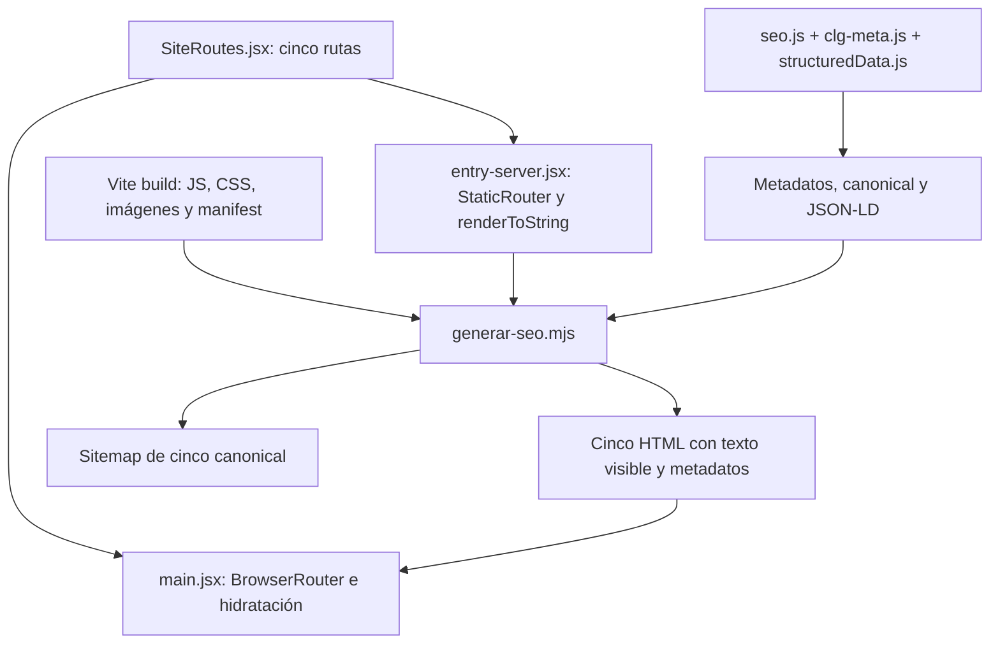

# PYP-025 — CLG, contenido inicial y SEO compartido

Fecha: 2026-10-18. [Prompt](../prompts/PYP-025.md), [confirmación adicional del usuario](../prompts/PYP-025-confirmacion-funciones.md), [informe y pruebas](../evidencias/PYP-025/resultado.md).

## Recorrido de implementación

La ruta /proyectos/clg se incorpora a las cuatro rutas existentes. Su canonical es https://pyptecnologia.com/proyectos/clg/. No se añade una página Proyectos: el breadcrumb y el enlace de regreso apuntan a la sección existente /#proyectos.

SiteRoutes.jsx contiene la composición de las cinco rutas y sus componentes Seo. Lo comparten la entrada del navegador y la entrada de prerenderizado. Las cuatro páginas anteriores conservan componentes y contenido; App.jsx solo recibe un enlace CLG en su tarjeta de Proyectos.

El build comercial conserva su secuencia Vite y después scripts/generar-seo.mjs. Vite emite .vite/manifest.json para relacionar los recursos importados con sus URLs compiladas. El generador usa un servidor Vite en modo middleware, sin abrir un puerto HTTP, para cargar la entrada SSR y renderizar los mismos componentes.

Los recursos /src/assets del render se sustituyen por las rutas /assets del manifest. Las cinco salidas se preparan y validan antes de escribirlas. El marcador de prerenderizado permite repetir la generación sin duplicar HTML; se verificó idempotencia por hashes.

No se introduce un servidor SSR de producción, un servicio externo, detección de bots, dependencias o cambios al comando comercial. Los HTML iniciales están disponibles para todos los visitantes. La caché del cargador se mantiene en node_modules/.cache/pyp-prerender, dentro del repositorio y fuera del artefacto público.

## Navegador y navegación

main.jsx usa hydrateRoot cuando el HTML inicial incluye data-prerendered=true. Durante desarrollo, donde Vite sirve la plantilla sin prerenderizar, utiliza createRoot. BrowserRouter y StaticRouter comparten SiteRoutes para mantener consistente el árbol React.

Navbar, SectionNav y scrollToSection se reutilizan sin cambios. El enlace nativo desde la tarjeta de Proyectos es rastreable en el HTML inicial de Inicio. Los CTA comerciales apuntan al formulario existente /#contacto; no se crea ni modifica un formulario.

Seo.jsx mantiene título, description, canonical y OG en cambios de ruta. Además añade o retira un único script page-structured-data según la página actual. Al salir de CLG hacia Inicio desaparecen Product/BreadcrumbList, y al regresar se recupera una sola instancia, según la prueba de navegación React.

## Fuentes de contenido y metadatos

| Fuente | Responsabilidad |
| --- | --- |
| clg-meta.js | Título y description CLG, imagen principal y dimensiones; módulo sin importaciones de bitmap para uso directo por Node |
| seo.js | Cinco páginas, dominio, canonical y selección de imagen OG por página |
| clg.js | Textos de las modalidades y siete respuestas visibles; referencias de las fotografías usadas por React |
| structuredData.js | BreadcrumbList y Product específicos de CLG, sin ofertas/reseñas o prestaciones inventadas |
| index.html | Declaraciones corporativas Organization/WebSite existentes y formulario oculto para Netlify |
| generar-seo.mjs | Head, contenido inicial y sitemap a partir de las fuentes anteriores |

La imagen pública /clg-audio-comercial.jpg es una copia exacta del recurso clg-audio-serie.jpg aportado antes de la intervención. Da una URL estable a OG y a la imagen principal; las demás fotografías pasan por el pipeline normal de Vite. El resto de páginas conserva la imagen OG corporativa.

Product solo describe identidad, imagen, marca y fabricante conocido mediante referencia al Organization existente. No se añade una segunda Organization. Las FAQ son contenido visible, sin FAQPage JSON-LD. Product semántico no supone elegibilidad para resultados enriquecidos de producto, cuyos requisitos adicionales no se rellenan con datos inventados.

## Alcance de las afirmaciones

PYP-024 aporta los hechos base: 47 unidades, red propietaria, programación local, administración remota con Internet, HAT, interfaces y entradas/salidas. Durante PYP-025 el usuario confirmó RTC/horarios, música con pausa para anuncios y conexión a amplificador. Se registra la procedencia en el prompt adicional, sin atribuir pruebas de firmware a Codex.

Las reglas evento-acción se definen por proyecto; Safety IP continúa como modalidad propuesta. No se atribuyen certificaciones de evacuación/incendios, supervisión, logs o audio IP avanzado. La captura de archivos no se presenta como supervisión ni la infografía como evidencia técnica.

## Validación y límites

Las pruebas locales cubren cinco HTML iniciales, preservación exacta de metadatos previos, nueve variantes HTTP, recursos, JSON-LD, hidratación, anclas, tres anchos de pantalla y CLG sin JavaScript. El servidor de prueba no emula los 301 de Netlify; las redirecciones públicas quedan para después de una publicación autorizada.

Los LCP/CLS registrados son mediciones de laboratorio, sin acreditar Core Web Vitals de campo o INP. No se usa Search Console ni se afirma indexación. La publicación, verificación CDN y solicitud de indexación quedan pendientes.

Referencias técnicas: [JavaScript SEO, Google](https://developers.google.com/search/docs/crawling-indexing/javascript/javascript-seo-basics), [hydrateRoot, React](https://react.dev/reference/react-dom/client/hydrateRoot).
