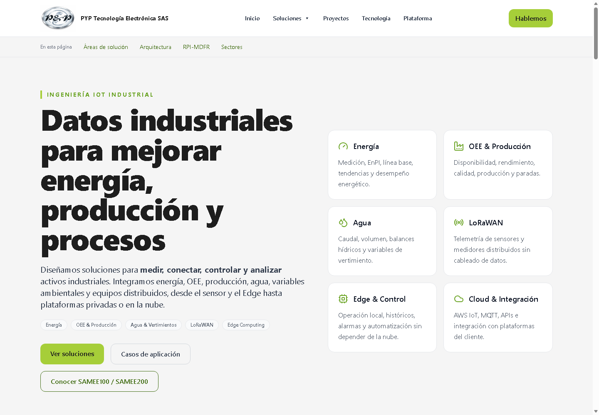
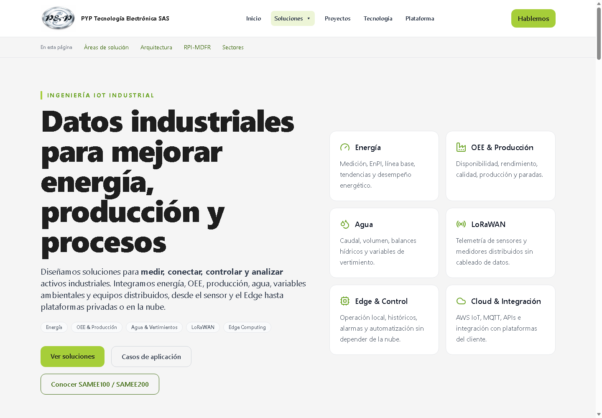
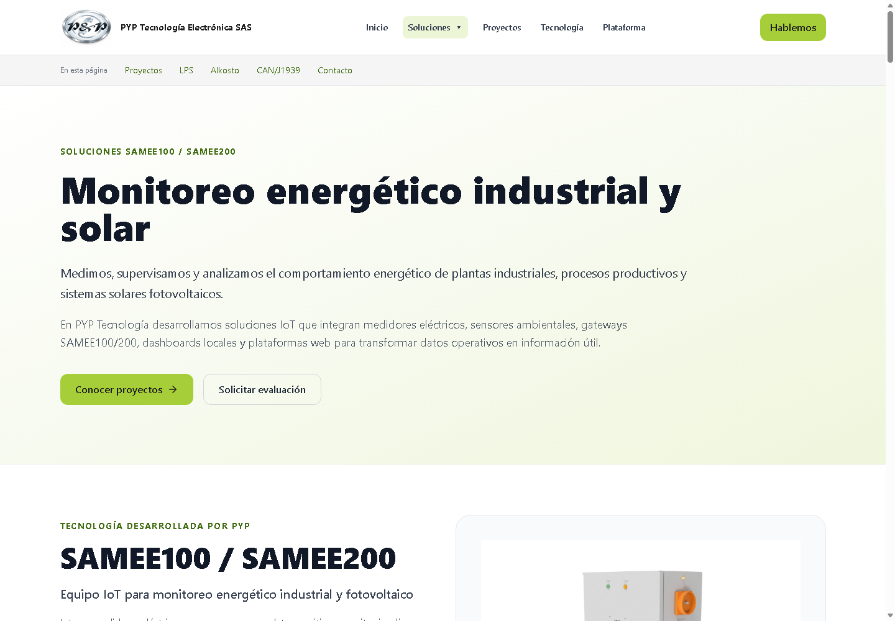
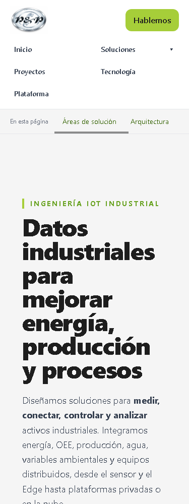
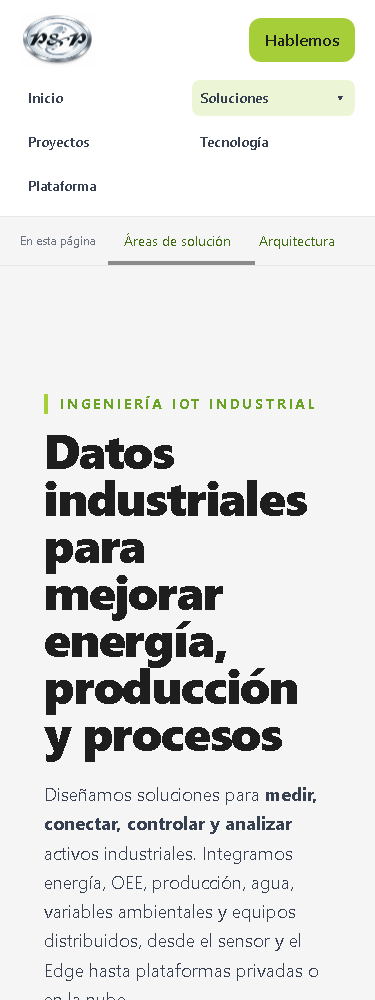
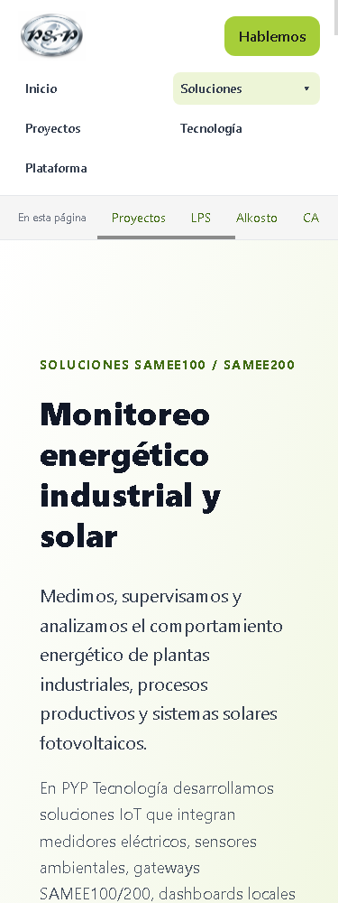

# PYP-012 — Robustez de navegación y botón Soluciones

Fecha: 2026-10-17. [Prompt completo, incluida ampliación visual](../../prompts/PYP-012.md).

## Diagnóstico antes de editar

[Causas registradas antes de modificar fuentes](./diagnostico-inicial.md). Estado Git y hashes en estado-inicial.json; copias previas de las dos fuentes en Navbar.jsx.before.txt y scrollToSection.js.before.txt. Se leyeron AGENTS, bitácora e informe PYP-009; se inspeccionaron main, Navbar, SectionNav y los ID/enlaces reales de las tres páginas interiores.

1. El helper ejecutaba decodeURIComponent sin manejar URIError. SectionNav lo llama en un efecto durante montaje/cambio de hash y en hashchange: /#% abortaba React. No era un error en la definición de rutas.

2. Navbar comparaba pathname literalmente con href tanto en el estado de Soluciones como en aria-current/clases de los enlaces. React Router ya reconoce /ruta/; la comparación visual no la reconocía.

3. El fondo verde del botón solo se aplicaba cuando activeSolution era true. Inicio quedaba transparente; Monitoreo mostraba #A6CE39 al 20%. La comparación anterior se documenta en visual-before.json y cuatro capturas antes-*.png del artefacto PYP-011 intacto.

## Correcciones

- src/utils/scrollToSection.js: captura exclusivamente alrededor de decodeURIComponent. URIError produce retorno sin inventar ID, enfocar ni programar un destino. Cualquier otro error se relanza. La cancelación del frame anterior, espera acotada del destino, comprobación ruta/hash, offset, foco, historial y preferencia de movimiento se conservan.

- src/components/Navbar.jsx: normalizedPathname elimina barras finales únicamente para comparar con las soluciones. Se aplica a aria-current y estilos del enlace activo. No modifica la URL, rutas registradas, canonical ni genera redirecciones.

- El botón Soluciones aplica siempre el mismo fondo #A6CE39/20 y clases que ya tenía Monitoreo. La solución actual sigue identificándose por separado en el enlace del desplegable, con borde #6BA425. No hay nueva Navbar ni duplicación de estilos. Se conservan hover, foco y manejadores de teclado/clic.

## Fuentes y alcance

Solo se modifican Navbar.jsx y scrollToSection.js como código funcional. main.jsx, SectionNav.jsx, las páginas, App.jsx/formulario Netlify, index.html, Seo.jsx, sitemap, dependencias y configuración comercial permanecen intactos. Los cambios previos se conservan. Documentación modificada: bitácora, índice de prompts y arquitectura; nuevos prompt y evidencias PYP-012.

## Casos y evidencias

La prueba browser-check.cjs utiliza Edge headless a 375 y 1440 px sobre artefactos locales. Bloquea POST y peticiones fuera del origen local; no contacta Plataforma ni envía formularios.

Casos: pares con/sin barra en las tres soluciones; aria-current/estilo idénticos y URL/canonical preservados; anclas existentes de las tres páginas; homepage con hash vacío, #, inexistente, %, UTF-8 incompleto y %GG; hash válido codificado; hashchange inválido, historial atrás/adelante; SectionNav con Enter; Soluciones con clic/Enter/ArrowDown/Tab/Escape; navegación corporativa a IoT, Proyectos, Contacto e Inicio; movimiento reducido instantáneo y movimiento normal suave; detección de excepciones y console.error.

Las capturas son comparativas con el artefacto anterior; no implican pruebas en dispositivos físicos. El código de la prueba y sus resultados JSON se conservan, sin afirmar resultados antes de su ejecución. Los resultados efectivos se añaden al cierre.

## Comparación visual escritorio

Inicio anterior:

Inicio corregido:

Monitoreo anterior:

Monitoreo conservado:

## Comparación visual móvil

Se emplea sintaxis de imagen para que VitePress incluya estas evidencias en el artefacto, evitando el problema previo de adjuntos enlazados como archivos.

## Compilaciones y comandos

Vite 6.4.1 comercial temporal: salida 0, 1600 módulos, 13.55 s. Generador SEO original desde cwd temporal: salida 0. Avisos previos de baseline-browser-mapping y Browserslist desactualizados; sin actualización de paquetes.

~~~powershell

node node_modules/vite/bin/vite.js build --outDir docs/evidencias/PYP-012/build-temporal/comercial/dist

# cwd: docs/evidencias/PYP-012/build-temporal/comercial

node D:/promate/web/pyp-web/scripts/generar-seo.mjs

# cwd: raíz del proyecto

node node_modules/vite/bin/vite.js preview --outDir docs/evidencias/PYP-012/build-temporal/comercial/dist --host 127.0.0.1 --port 5183 --strictPort

node docs/evidencias/PYP-012/browser-check.cjs

node docs/evidencias/PYP-012/build-docs.mjs

~~~

La salida documental usa la API build de VitePress con onAfterConfigResolve para aislar también tempDir, cacheDir y vite.cacheDir en build-temporal (no basta cambiar outDir, porque SSR escribe en .vitepress/.temp). No se modifica la configuración permanente: no se ejecuta el build comercial sobre dist ni se reutilizan salidas generadas anteriores. El resultado VitePress se registra al terminar.

## Riesgos y pendientes

Pruebas físicas, otros motores y lector de pantalla siguen pendientes. Capturar URIError no significa ocultar otros fallos; un hash inexistente conserva la espera previa máxima de dos segundos y se cancela al cambiar de navegación. El estado activo solo normaliza barras finales; no introduce otras normalizaciones ni nuevas rutas.

Permanecen los hallazgos ajenos de PYP-009 (SEO/Netlify, seguridad, favicon y adjuntos documentales antiguos). La recepción Netlify de PYP-011 sigue pendiente, sin enviar formularios. main.jsx:45 mantiene su whitespace previo. Los manifiestos de commit antiguos no incorporan automáticamente PYP-012.

Sin instalación, staging, commit, push, reset, clean ni despliegue. Estado final, integridad y whitespace en validacion-final.json y cierre de bitácora.

### Resultado de navegador

177 comprobaciones pasadas en Edge headless a 375 y 1440 px; ninguna excepción ni console.error. Ocho capturas comparativas generadas; las cuatro posteriores se inspeccionaron visualmente. Fondo calculado idéntico Inicio/Monitoreo: rgba(166, 206, 57, 0.2); tratamiento anterior de las páginas interiores conservado. La captura anterior utiliza el artefacto PYP-011, que permanece intacto.

### Cierre de PYP-012

189 comprobaciones pasadas: 177 de navegación y 12 complementarias de hover, foco visible y contraste en Inicio/Monitoreo a 375/1440 px. Sin excepciones ni console.error en la navegación. Ocho capturas comparativas generadas; cuatro posteriores inspeccionadas. Contraste calculado sobre fondo blanco: aproximadamente 8,90–8,99:1, comprobación local complementaria sin certificación WCAG. Dos intentos iniciales de hover fallaron por sincronización/transición CSS; se conservaron en visual-states-first-attempt.json, visual-states-second-attempt.json y visual-states-failure.json. La prueba espera ahora el color final antes de comprobarlo; no se modificaron estilos para resolver esos fallos de prueba. Resultado definitivo en visual-states.json.

VitePress compiló con salida 0 en 24.81 s mediante build-docs.mjs: salida, cachés e intermediarios SSR aislados en build-temporal. Las ocho referencias de capturas del informe tienen assets existentes en el HTML compilado (VitePress deduplica la captura de Monitoreo desktop idéntica). Los cambios de cierre posteriores son documentales; no se repitió la compilación tras añadir este resultado.

Integridad: 673 archivos previos comparados por SHA-256, sin eliminaciones ni cambios fuera de Navbar, helper y los tres documentos autorizados. Se excluyen .git, node_modules, browser-profile y cache. Los 17 archivos de dist y 505 generados previos inventariados permanecen idénticos; App.jsx, formulario/index.html, main.jsx, SectionNav, páginas, SEO y dependencias conservan sus contenidos. Índice Git intacto.

Whitespace de rutas afectadas y archivos nuevos correcto; enlaces locales nuevos/actualizados sin destinos inexistentes. El chequeo global conserva el espacio final previo en main.jsx:45 (salida 2) y avisos LF/CRLF. Git final: main, diez archivos seguidos modificados previos y 142 sin seguimiento al incluir validacion-final.json. Navbar y helper todavía aparecen como nuevos porque no estaban versionados; no se ejecuta staging. Evidencia completa en validacion-final.json. Sin dependencias nuevas, envíos de formularios, commit, push, reset, clean ni despliegue.
